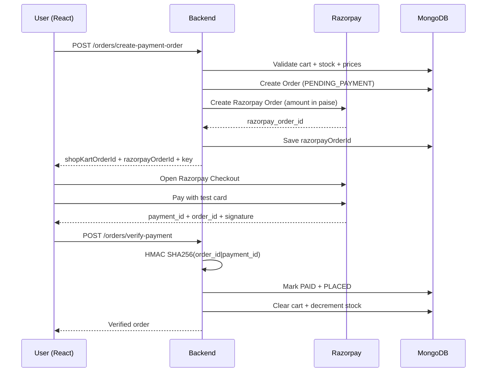

<div align="center">

# 🛒 ShopKart

### A full-stack MERN e-commerce application with JWT auth, persistent cart, wishlist, Razorpay payments and order history.

[](https://shopkart-delta-eight.vercel.app/)
[](https://shopkart-api-g41f.onrender.com)
[](https://www.mongodb.com/atlas)
[](https://react.dev)
[](https://nodejs.org)

**Test Mode is enabled.** Use Razorpay test card `4100 2800 0000 1007`, any CVV, any future expiry, OTP `1234`.

</div>

---

## 🌐 Live Deployment

| Layer                    | URL                                           |
| ------------------------ | --------------------------------------------- |
| **Frontend** (Vercel)    | https://shopkart-delta-eight.vercel.app/      |
| **Backend API** (Render) | https://shopkart-api-g41f.onrender.com        |
| **Health check**         | https://shopkart-api-g41f.onrender.com/health |
| **Database**             | MongoDB Atlas (M0 free tier)                  |
| **Payments**             | Razorpay Test Mode                            |

> ⏱️ Render free tier sleeps after 15 min of inactivity. First request after sleep takes ~30s.

---

## ✨ Features

<table>
<tr>
<td width="50%" valign="top">

### 🔐 Authentication

- Email + password registration
- bcrypt password hashing (10 rounds)
- JWT stored in **HttpOnly, Secure, SameSite=None** cookie
- Protected routes (backend middleware + React guard)
- Profile, logout, change password

### 🛍️ Product Catalog

- Full CRUD-ready product model
- Case-insensitive **search** by name
- **Category filter** + multi-field **sorting**
- 10 seeded demo products across 4 categories
- Pagination-ready backend (extendable)

### ❤️ Wishlist

- MongoDB relationship: `Customer.wishlist: [ObjectId ref "Product"]`
- `populate()` for enriched reads
- Duplicate prevention (`409 Conflict`)
- Toggle endpoint + navbar count badge
- Optimistic UI with rollback

</td>
<td width="50%" valign="top">

### 🛒 Cart

- `Customer.cart: [{ product, quantity }]`
- Add / increment / set quantity / remove
- **Stock validation** on every mutation
- Global state via Context API
- Derived subtotal, unit count, item count
- Persists across refresh and re-login

### 💳 Checkout & Orders

- Shipping form with client + server validation
- **Server-owned totals** (never trusts client)
- Order **snapshots** product name/price/image
- Razorpay Order created server-side
- **HMAC SHA256 signature verification**
- Cart cleared only after verified payment
- Order history with ownership enforcement

### 🎨 Polish

- Framer Motion page transitions + toasts
- GSAP hero timeline + scroll parallax + grid stagger
- React Three Fiber 3D hero (lazy-loaded)
- Fully responsive (mobile → 4K)
- Reduced-motion accessibility support

</td>
</tr>
</table>

---

## 🧱 Tech Stack

<table>
<tr>
<td valign="top" width="33%">

**Backend**

- Node.js 20+
- Express 4
- MongoDB + Mongoose 8
- bcryptjs
- jsonwebtoken
- cookie-parser
- Razorpay Node SDK
- Node `crypto` (HMAC)

</td>
<td valign="top" width="33%">

**Frontend**

- React 18 + Vite
- React Router DOM 6
- Axios (with `withCredentials`)
- Tailwind CSS 3
- Framer Motion
- GSAP + ScrollTrigger
- React Three Fiber + drei

</td>
<td valign="top" width="33%">

**Infrastructure**

- MongoDB Atlas (M0)
- Render (backend Web Service)
- Vercel (frontend)
- Razorpay (Test Mode)
- GitHub (source)

</td>
</tr>
</table>

---

## 📁 Project Structure

```
shopkart/
│
├── backend/
│   ├── config/
│   │   ├── db.js                # Mongoose connection + DNS fallback
│   │   ├── env.js               # Loads dotenv FIRST (import-order fix)
│   │   └── razorpay.js          # Lazy Razorpay factory
│   │
│   ├── controllers/
│   │   ├── customer.controller.js   # register, login, me, logout, change-password
│   │   ├── product.controller.js    # CRUD + search/filter/sort
│   │   ├── wishlist.controller.js   # add, get, remove, toggle, count
│   │   ├── cart.controller.js       # add, get, update-qty, remove, count
│   │   └── order.controller.js      # create-payment-order, verify-payment, get orders
│   │
│   ├── middlewares/
│   │   └── auth.middleware.js       # Verifies JWT cookie, attaches req.user
│   │
│   ├── models/
│   │   ├── customer.model.js        # fullName, email, password, phone, wishlist[], cart[]
│   │   ├── product.model.js         # name, description, price, category, image, stock
│   │   └── order.model.js           # items[] (snapshot), shippingAddress, totalAmount, paymentStatus
│   │
│   ├── routes/
│   │   ├── customer.routes.js
│   │   ├── product.routes.js
│   │   ├── wishlist.routes.js
│   │   ├── cart.routes.js
│   │   └── order.routes.js
│   │
│   ├── utils/
│   │   └── generateToken.js
│   │
│   ├── seedProducts.js           # Seeds 10 demo products
│   ├── .env.example
│   ├── .gitignore
│   ├── package.json
│   └── index.js
│
├── frontend/
│   ├── public/
│   │   └── shopkart.svg
│   │
│   ├── src/
│   │   ├── components/
│   │   │   ├── motion/
│   │   │   │   ├── PageTransition.jsx
│   │   │   │   ├── FadeIn.jsx
│   │   │   │   ├── Stagger.jsx
│   │   │   │   └── PressButton.jsx
│   │   │   ├── three/
│   │   │   │   ├── Hero3D.jsx
│   │   │   │   └── LazyHero3D.jsx
│   │   │   ├── Navbar.jsx
│   │   │   ├── ProtectedRoute.jsx
│   │   │   ├── ProductCard.jsx
│   │   │   ├── WishlistButton.jsx
│   │   │   ├── WishlistCard.jsx
│   │   │   ├── AddToCartButton.jsx
│   │   │   ├── CartItem.jsx
│   │   │   └── SearchBar.jsx
│   │   │
│   │   ├── context/
│   │   │   ├── AuthContext.jsx
│   │   │   ├── ToastContext.jsx
│   │   │   ├── WishlistContext.jsx
│   │   │   └── CartContext.jsx
│   │   │
│   │   ├── lib/
│   │   │   └── gsap.js
│   │   │
│   │   ├── pages/
│   │   │   ├── Login.jsx
│   │   │   ├── Register.jsx
│   │   │   ├── Home.jsx
│   │   │   ├── Products.jsx
│   │   │   ├── ProductDetails.jsx
│   │   │   ├── Wishlist.jsx
│   │   │   ├── Cart.jsx
│   │   │   ├── Checkout.jsx
│   │   │   ├── OrderSuccess.jsx
│   │   │   ├── Orders.jsx
│   │   │   └── OrderDetails.jsx
│   │   │
│   │   ├── services/
│   │   │   └── api.js
│   │   │
│   │   ├── utils/
│   │   │   └── loadRazorpay.js
│   │   │
│   │   ├── App.jsx
│   │   ├── main.jsx
│   │   └── index.css
│   │
│   ├── .env.example
│   ├── .npmrc
│   ├── vercel.json
│   ├── tailwind.config.js
│   ├── postcss.config.js
│   ├── vite.config.js
│   ├── index.html
│   └── package.json
│
├── postman/
│   └── ShopKart.postman_collection.json
│
├── package.json                  # Root convenience scripts
├── README.md                     # 👈 you are here
└── LICENSE
```

---

## 🚀 Local Setup

### Prerequisites

- **Node.js** ≥ 20 ([download](https://nodejs.org))
- **MongoDB Atlas** account ([free M0 tier](https://cloud.mongodb.com))
- **Razorpay** account in Test Mode ([sign up](https://dashboard.razorpay.com/signup))
- **Git**

### 1. Clone

```bash
git clone https://github.com/<your-username>/shopkart.git
cd shopkart
```

### 2. Install everything

```bash
npm install            # root (concurrently)
npm run install:all    # backend + frontend
```

### 3. Configure backend env

```bash
cp backend/.env.example backend/.env
```

Edit `backend/.env`:

```env
PORT=5000
NODE_ENV=development

MONGO_URI=mongodb://...your_atlas_connection_string.../shopkart?retryWrites=true&w=majority

JWT_SECRET=replace_with_a_long_random_string_here
JWT_EXPIRES_IN=7d

CLIENT_URL=http://localhost:5173

RAZORPAY_KEY_ID=rzp_test_xxxxxxxxxxxxxx
RAZORPAY_KEY_SECRET=your_test_secret
```

**Where to get Razorpay keys:**
Dashboard → toggle **Test Mode** ON → Settings → API Keys → Generate Test Key.

### 4. Configure frontend env

```bash
cp frontend/.env.example frontend/.env.local
```

Default content:

```env
VITE_API_URL=http://localhost:5000
```

### 5. Seed the database

```bash
cd backend
node seedProducts.js
cd ..
```

Expected: `🌱 Seeded 10 products`.

### 6. Run both servers

```bash
# from shopkart/ root
npm run dev
```

- Frontend: http://localhost:5173
- Backend: http://localhost:5000

> If port 5173 is busy, Vite will complain loudly (`strictPort: true`). Kill the process holding it, or add the new port to `CLIENT_URL`.

---

## 🔌 API Reference

Base URL (dev): `http://localhost:5000`
Base URL (prod): `https://shopkart-api-g41f.onrender.com`

All protected routes require the `token` cookie (set automatically after login).

### 🔐 Auth - `/customers`

| Method  | Endpoint                     | Auth | Purpose                      |
| ------- | ---------------------------- | :--: | ---------------------------- |
| `POST`  | `/customers/register`        |  –   | Register new customer        |
| `POST`  | `/customers/login`           |  –   | Login (sets HttpOnly cookie) |
| `GET`   | `/customers/me`              |  ✅  | Current user profile         |
| `POST`  | `/customers/logout`          |  ✅  | Clear auth cookie            |
| `PATCH` | `/customers/change-password` |  ✅  | Update password              |

<details>
<summary><b>Example: Register</b></summary>

```http
POST /customers/register
Content-Type: application/json

{
  "fullName": "John Doe",
  "email": "john@example.com",
  "password": "john123",
  "phone": "9876543210"
}
```

**201 Created**

```json
{
    "success": true,
    "message": "Customer registered successfully",
    "customer": {
        "_id": "...",
        "fullName": "John Doe",
        "email": "john@example.com",
        "phone": "9876543210"
    }
}
```

**409 Conflict** (duplicate email)

```json
{ "success": false, "message": "Email already registered" }
```

</details>

### 🛍️ Products - `/products`

| Method | Endpoint               | Auth | Purpose                                    |
| ------ | ---------------------- | :--: | ------------------------------------------ |
| `POST` | `/products`            |  –   | Create product                             |
| `GET`  | `/products`            |  –   | List - supports `?search=&category=&sort=` |
| `GET`  | `/products/:id`        |  –   | Single product                             |
| `GET`  | `/products/categories` |  –   | Distinct categories                        |

**Query examples**

```
GET /products?search=keyboard
GET /products?category=Electronics
GET /products?search=mouse&category=Electronics
GET /products?sort=price_asc|price_desc|name_asc|name_desc
```

### ❤️ Wishlist - `/wishlist` (all protected)

| Method   | Endpoint                      | Purpose                               |
| -------- | ----------------------------- | ------------------------------------- |
| `GET`    | `/wishlist`                   | Current user's populated wishlist     |
| `POST`   | `/wishlist/:productId`        | Add (409 if already present)          |
| `DELETE` | `/wishlist/:productId`        | Remove                                |
| `PATCH`  | `/wishlist/:productId/toggle` | Toggle (returns `{ saved: boolean }`) |
| `GET`    | `/wishlist/count`             | Count for navbar badge                |

### 🛒 Cart - `/cart` (all protected)

| Method   | Endpoint           | Purpose                            |
| -------- | ------------------ | ---------------------------------- |
| `GET`    | `/cart`            | Current user's populated cart      |
| `POST`   | `/cart/:productId` | Add or increment                   |
| `PATCH`  | `/cart/:productId` | Set quantity (`{ "quantity": 3 }`) |
| `DELETE` | `/cart/:productId` | Remove                             |
| `GET`    | `/cart/count`      | Total units                        |

### 💳 Orders - `/orders` (all protected)

| Method  | Endpoint                       | Purpose                                         |
| ------- | ------------------------------ | ----------------------------------------------- |
| `POST`  | `/orders/create-payment-order` | Validate cart, create ShopKart + Razorpay order |
| `POST`  | `/orders/verify-payment`       | Verify signature, mark PAID, clear cart         |
| `GET`   | `/orders`                      | Current user's orders                           |
| `GET`   | `/orders/:id`                  | Single order (ownership enforced)               |
| `PATCH` | `/orders/:id/status`           | Bonus: manual status progression                |

<details>
<summary><b>Example: Create payment order</b></summary>

```http
POST /orders/create-payment-order
Content-Type: application/json
Cookie: token=...

{
  "shippingAddress": {
    "fullName": "Aarav Sharma",
    "phone": "9876543210",
    "addressLine1": "22 MG Road",
    "city": "Bengaluru",
    "state": "Karnataka",
    "pincode": "560001"
  }
}
```

**201 Created**

```json
{
    "success": true,
    "shopKartOrderId": "67abc...",
    "razorpayOrderId": "order_ABC123",
    "amount": 749700,
    "currency": "INR",
    "key": "rzp_test_xxxxxxxx"
}
```

</details>

---

## 💳 Razorpay Test Flow



### Test Cards

| Network    | Number                |
| ---------- | --------------------- |
| Visa       | `4100 2800 0000 1007` |
| Mastercard | `5555 5100 0008 1006` |
| RuPay      | `6527 6589 0000 1005` |
| Amex       | `3402 560004 01007`   |

CVV: any 3 digits · Expiry: any future date · OTP: `1234`

---

## 🔐 Security Notes

- ✅ Passwords hashed with **bcrypt** (10 rounds)
- ✅ JWT in **HttpOnly, Secure, SameSite=None** cookie
- ✅ `RAZORPAY_KEY_SECRET` **never leaves the backend**
- ✅ Total always recomputed server-side from latest product prices
- ✅ **HMAC SHA256 signature verified** before marking payment successful
- ✅ Order **ownership enforced** on every order read
- ✅ **CORS whitelist** via `CLIENT_URL`
- ✅ `trust proxy` enabled behind Render
- ✅ `.env` gitignored; `.env.example` committed

---

## 📦 Deployment

### Backend → Render

1. New **Web Service** → connect GitHub repo
2. **Root Directory**: `backend`
3. **Build Command**: `npm install`
4. **Start Command**: `npm start`
5. **Environment Variables**:
    ```
    NODE_ENV=production
    MONGO_URI=mongodb://...
    JWT_SECRET=<long random string>
    JWT_EXPIRES_IN=7d
    CLIENT_URL=http://localhost:5173,https://shopkart-<you>.vercel.app
    RAZORPAY_KEY_ID=rzp_test_xxx
    RAZORPAY_KEY_SECRET=xxx
    ```

### Frontend → Vercel

1. New **Project** → import repo
2. **Root Directory**: `frontend`
3. **Framework**: Vite
4. **Build Command**: `npm run build`
5. **Output Directory**: `dist`
6. **Environment Variables**:
    ```
    VITE_API_URL=https://shopkart-api-g41f.onrender.com
    ```

### MongoDB Atlas checklist

- ✅ Cluster **Active**
- ✅ **Database Access** → DB user with read/write
- ✅ **Network Access** → allow Render outbound IPs (or `0.0.0.0/0` for dev)

---

## 🧪 Testing

### Backend

Import `postman/ShopKart.postman_collection.json` into Postman.
Set collection variable `baseUrl` = `http://localhost:5000`.

### Frontend

```bash
cd frontend
npm run dev
```

Manual smoke test: register → login → browse → wishlist → cart → checkout → Razorpay test payment → orders.

### Automated (optional CI)

See `.github/workflows/ci.yml` - lints backend and builds frontend on every push.

---

## 🐛 Troubleshooting

| Symptom                        | Fix                                                                                                                      |
| ------------------------------ | ------------------------------------------------------------------------------------------------------------------------ |
| `querySrv EBADRESP`            | Use direct MongoDB connection string (see `backend/.env.example`) or add `dns.setServers(["8.8.8.8"])` in `config/db.js` |
| CORS error on login            | Check `CLIENT_URL` on Render contains exact Vercel origin (no trailing slash)                                            |
| Cookies not set in production  | Confirm `NODE_ENV=production` → cookie gets `SameSite=None; Secure`                                                      |
| Vercel 404 on refresh          | Confirm `frontend/vercel.json` exists with SPA rewrites                                                                  |
| Vercel `ERESOLVE`              | Confirm `@react-three/drei@9.114.3` (pinned) and `frontend/.npmrc` has `legacy-peer-deps=true`                           |
| Razorpay modal opens but fails | Verify `RAZORPAY_KEY_ID` on Render matches client bundle key                                                             |

---

## 🎓 Learning Outcomes

This project demonstrates production-grade MERN skills:

- **REST API design** in clean MVC
- **MongoDB relationships** with `ObjectId` refs + `populate()`
- **Document snapshotting** for historical accuracy in orders
- **JWT auth** across sites with HttpOnly cookies
- **Payment integration** with server-side HMAC verification
- **Global state** in React via Context API (with optimistic updates)
- **Derived state** - subtotal, count never stored, always computed
- **Animation** with Framer Motion + GSAP + React Three Fiber
- **Deployment** on Render + Vercel + MongoDB Atlas
- **Security best practices** - env handling, secret isolation, ownership checks

---

## 📄 License

MIT - free for learning and portfolio use. See [LICENSE](./LICENSE).

---

<div align="center">

**Built with ☕ and clean code.**

</div>
